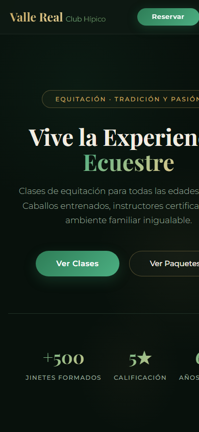

# 🐴 Club Hípico — Sistema de Reservaciones


**Demo:** https://clubhipico.vercel.app


Sistema de reservas de clases de equitación con panel de administración,
paquetes mensuales con descuento automático, notificaciones por Telegram y
correo (recordatorios automáticos a clientes).

**Stack:** Node.js + Express · Supabase (PostgreSQL) · Frontend HTML/vanilla JS
**Hosting:** Backend en Render.com · Frontend en Vercel

**Puntos técnicos destacados**
- Cupo máximo por horario, configurable desde el panel sin volver a desplegar.
- Paquetes mensuales: el sistema detecta el paquete activo por teléfono, descuenta la clase y la devuelve si se cancela la reserva.
- Panel protegido con token firmado (HMAC) con expiración, comparación en tiempo constante y límite de intentos.
- Tareas programadas (cron): recordatorios por correo (Resend) y Telegram, limpieza diaria de clases pasadas y expiración de paquetes.

| Escritorio | Móvil |
|---|---|
|  |  |

---

## 1. Base de datos (Supabase)

1. Crea un proyecto en [supabase.com](https://supabase.com) (o usa el existente).
2. Ve a **SQL Editor → New query**, pega TODO el contenido de `supabase.sql` y ejecútalo.
   Esto crea las tablas: `servicios`, `citas`, `dias_bloqueados`, `horas_bloqueadas`,
   `paquetes_cliente`, `configuracion` + datos iniciales.
3. Copia la cadena de conexión: **Project Settings → Database → Connection string → URI**
   (recomendado el *Session pooler*, puerto 5432). Reemplaza `[YOUR-PASSWORD]`.
   ⚠️ **Nunca pegues tu URI real en este archivo** — va solo en las variables de entorno de Render
   (y en tu `.env` local, que está ignorado por `.gitignore`).
   💡 En Render usa la URI del **Session pooler** (`...pooler.supabase.com:5432/postgres`),
   no la directa (`db.xxx.supabase.co`), porque Render conecta por IPv4.

## 2. Backend (Render)

1. Sube este repo a GitHub.
2. En [render.com](https://render.com) → **New → Web Service** → conecta el repo.
3. Configuración:
   - **Runtime:** Node
   - **Build Command:** `npm install`
   - **Start Command:** `node server.js`
4. En **Environment** agrega las variables del archivo `.env.example`:
   - `DATABASE_URL` ← cadena de Supabase
   - `ADMIN_PASS` ← contraseña del panel admin
   - `TOKEN_SECRET` ← cadena larga aleatoria (ej. `openssl rand -hex 32`)
   - `FRONTEND_URL` ← URL de tu sitio en Vercel (paso 3)
   - `TELEGRAM_BOT_TOKEN` / `TELEGRAM_CHAT_ID` (opcional, notificaciones admin)
   - `RESEND_API_KEY` / `MAIL_FROM` (opcional, correos a clientes)
5. Copia la URL que te da Render (ej. `https://clubhipico-api.onrender.com`).

> ⚠️ Los cron jobs (recordatorios) solo funcionan en Render/Railway, NO en Vercel serverless.

## 3. Frontend (Vercel)

1. Abre `public/index.html` y edita esta línea con tu URL de Render:
   ```js
   const API_URL = location.hostname.includes('localhost')
     ? 'http://localhost:3001/api'
     : 'https://TU-SERVICIO.onrender.com/api'; // ← aquí
   ```
2. En [vercel.com](https://vercel.com) → **Add New → Project** → importa el repo.
   - **Framework Preset:** Other
   - El `vercel.json` ya configura que solo se publique la carpeta `public/`.
3. Vuelve a Render y agrega la URL de Vercel en `FRONTEND_URL`.

## 4. Desarrollo local

```bash
npm install
cp .env.example .env   # llena tus credenciales
npm start              # abre http://localhost:3001
```

---

## Funcionalidades

### Público
- Reserva de clases con calendario y cupo visible por horario ("3 lugares")
- Paquetes mensuales informativos (4/8/12/16 clases, vigencia 30 días)
- Detección automática de paquete activo al escribir el teléfono → descuento de clase
- Correo de confirmación al reservar (si el cliente dejó email)

### Panel Admin (`botón Admin`)
- Dashboard, agenda semanal navegable, gestión de estados (confirmar/completar/cancelar)
- Cancelar una reserva de paquete **devuelve la clase** al paquete
- Disponibilidad: bloquear días completos u horas puntuales
- **Paquetes**: registrar compras (vigencia +30 días automática), extender, anular, reactivar
- CRM de clientes, estadísticas e ingresos
- Configuración: cupo máximo por horario (editable sin re-deploy), redes sociales, textos

### Automático (crons en Render)
- ⏰ Recordatorio a clientes por correo + Telegram (~24 h antes, configurable)
- 🧹 Limpieza diaria: auto-completar clases pasadas y expirar paquetes vencidos

## Horario del club (configurado)

| Día | Horas disponibles para reservar |
|---|---|
| Martes – Viernes | 8:00 – 16:00 (última clase inicia 4 PM) |
| Sábado | 8:00 – 14:00 |
| Domingo | 11:00 – 14:00 |
| Lunes | Cerrado |

Para cambiarlo edita `HORARIOS` en `server.js` y `HORARIO_SEMANA` en `public/index.html`.
